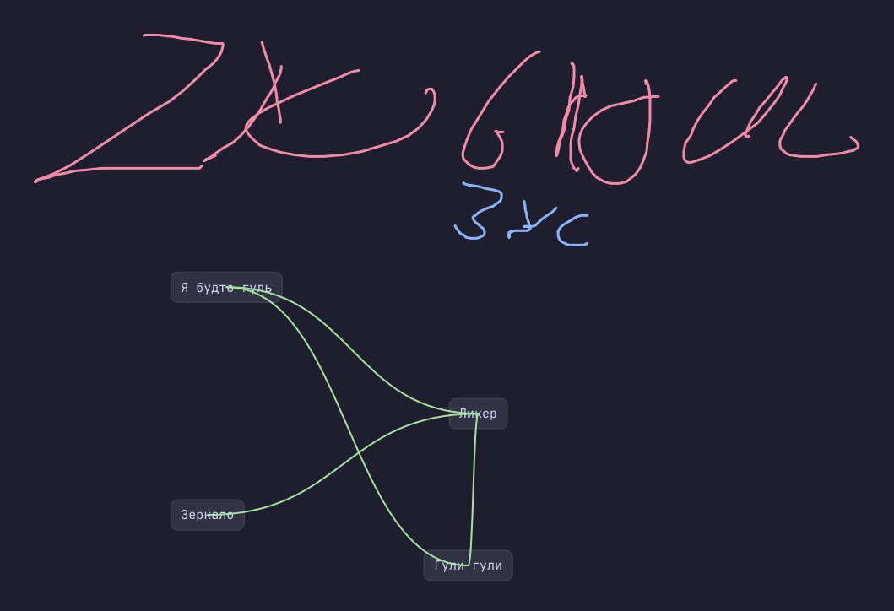

# Infinite Canvas (DBS)

> 🌐 **Language:** **English** | [Русский (README_Ru.md)](README_Ru.md)

An interactive desktop whiteboard and infinite canvas application built with **Python** and **PyQt6**, inspired by Obsidian Canvas and Miro.



## ✨ Features
- 🖌️ **Freehand Drawing (`PEN`)** — sketch freely anywhere on the canvas with customizable stroke color and width.
- 📝 **Text Cards (`TEXT`)** — create draggable, editable note cards on the board.
- 🖼️ **Image Cards (`ImageCardItem`)** — drop and arrange images freely across the canvas.
- 🔗 **Directed Links (`LINK`)** — connect cards and items with directional connector lines.
- 💾 **Save & Load** — serialize the entire scene to JSON and export the canvas.
- 🔍 **Smooth Zoom & Pan** — fluid mouse-wheel zooming and infinite canvas panning.

## 🚀 Installation & Usage

```bash
python3 -m venv venv
source venv/bin/activate
pip install -r requirements.txt
python3 canvas.py
```
